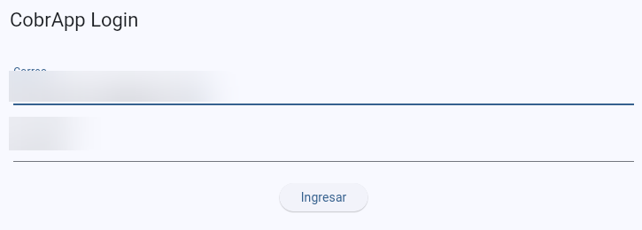
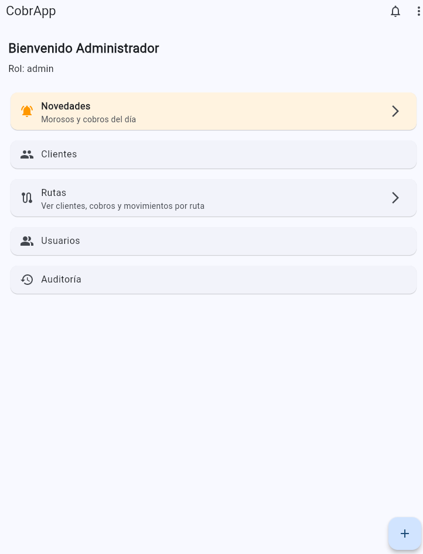
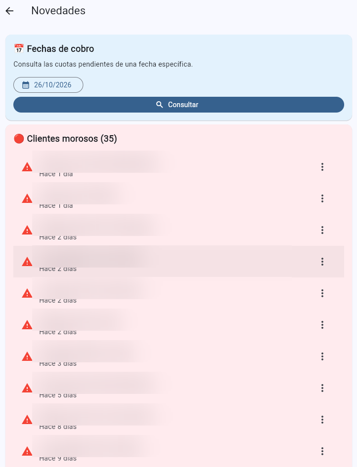
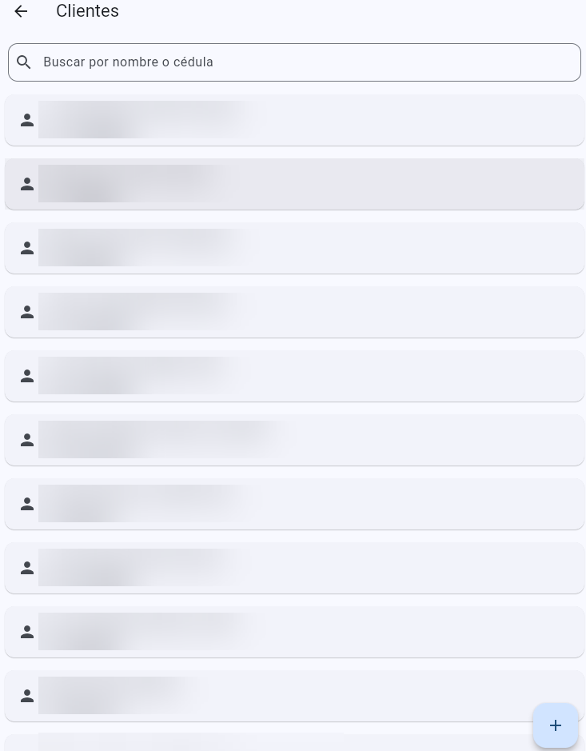
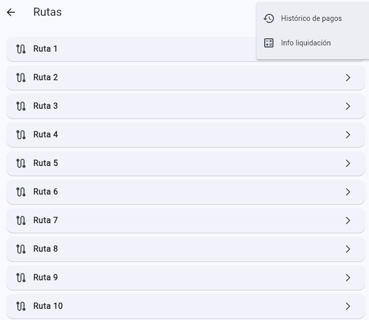
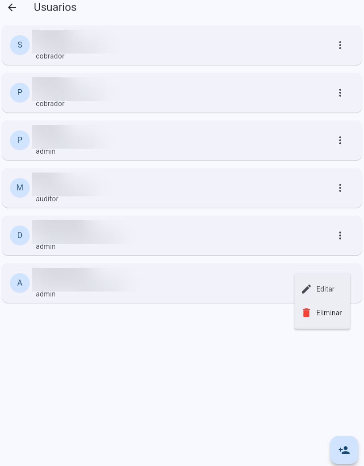
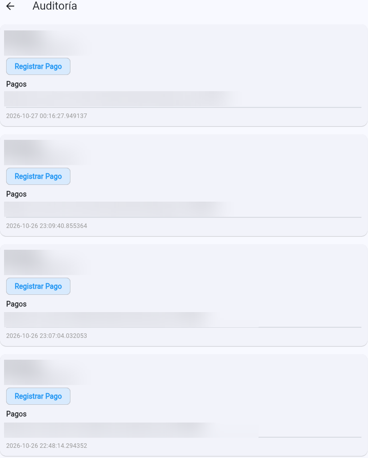

# CobrApp — Caso de estudio

CobrApp es una aplicación de gestión de créditos y cobranza desarrollada para apoyar operaciones como el seguimiento de clientes, cuotas, pagos y rutas de cobro.

Este repositorio de portafolio presenta una selección limitada de funcionalidades, cuatro servicios representativos y capturas de pantalla. No pretende exponer toda la aplicación ni sustituir la documentación interna del proyecto.

## Problema

La gestión manual de créditos y cobranza puede dificultar el seguimiento de cuotas, el cálculo de saldos, la administración del dinero por rutas y la atención de solicitudes de cambio de fecha.

## Solución

CobrApp organiza estos procesos en una aplicación con módulos para clientes, créditos, cuotas, pagos, rutas, novedades, usuarios y auditoría.

## Funcionalidades destacadas

### 1. Gestión de créditos — `creditos_service.dart`

- Creación de créditos y preparación de sus cuotas.
- Consulta de créditos asociados a un cliente.
- Actualización de los parámetros del crédito.
- Regeneración de cuotas.
- Eliminación del crédito mediante una función transaccional del backend y limpieza posterior de comprobantes.

### 2. Motor de pagos y mora — `motor_pagos_service.dart`

- Distribución de pagos entre capital, intereses y mora.
- Procesamiento de abonos y saldos pendientes.
- Aplicación de pagos a capital e intereses sin destinar ese pago a la mora.
- Registro de movimientos de pago.

### 3. Bases y liquidación de rutas — `liquidacion_service.dart`

- Consulta de saldos de la base de una ruta y de un cobrador.
- Registro de entradas y salidas mediante funciones del backend.
- Transferencias de la base de una ruta a la base de un cobrador.
- Consulta de movimientos y del usuario que los registró.
- Consulta de cobradores activos asignados a una ruta.

### 4. Reprogramación de fechas de cobro — `reprogramaciones_service.dart`

- Consulta de solicitudes de reprogramación pendientes.
- Asociación de solicitudes con cuotas y clientes.
- Envío de solicitudes para aprobación o rechazo mediante una función del backend.
- Conteo de solicitudes pendientes.

Las operaciones delegadas a funciones SQL dependen de la implementación del backend y sus políticas de seguridad. Esta descripción no sustituye una auditoría de permisos ni garantiza que todas las reglas estén cubiertas únicamente por los servicios Dart.

## Tecnologías

- Flutter
- Dart
- Supabase
- PostgreSQL

## Capturas de pantalla

Las siguientes capturas muestran algunas pantallas de la aplicación. Los datos identificativos visibles se han difuminado para preparar el material de portafolio.

### Inicio de sesión

### Panel principal

### Novedades y clientes en mora

### Clientes

### Rutas

### Usuarios y roles

### Auditoría

## Muestra de código

La muestra de código prevista contiene únicamente estos cuatro servicios:

- `creditos_service.dart`
- `motor_pagos_service.dart`
- `liquidacion_service.dart`
- `reprogramaciones_service.dart`

No se incluye el resto de la aplicación.

## Contacto

**Teo Acevedo** — Desarrollador de software

- GitHub: https://github.com/TEOACEVEDO
- LinkedIn: https://www.linkedin.com/in/teoacevedo/
- Gmail: teoacevedo.ma@gmail.com
- 
Para consultas sobre aplicaciones móviles, sistemas empresariales y automatización, puedes contactarme a través de mi correo.
